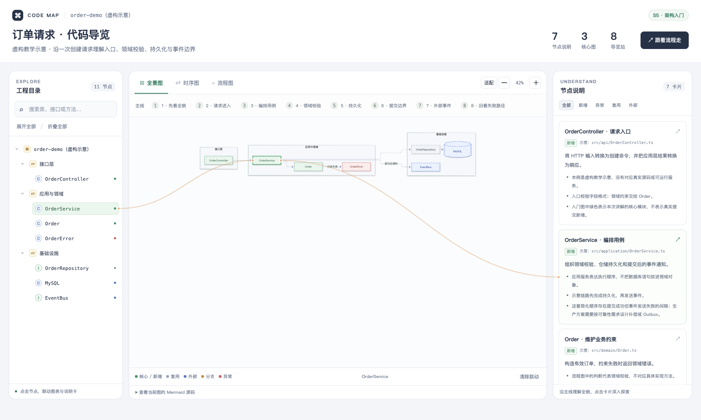

# Coding Map Skill · 代码地图

把一个功能、一次迭代或一份需求，整理成可以点击、可以按步骤阅读的代码导览。

这是一个供 AI Agent 使用的 Skill：Agent 阅读源码和变更，生成结构化地图数据；构建器把数据、交互引擎和 Mermaid 打包为**一个离线 HTML 文件**。读者用浏览器打开即可，无需安装依赖或启动服务。



## 能力

- **工程树**：按模块、包、类、接口、方法组织，支持搜索、展开和折叠。
- **三类图**：架构全景图、运行时序图、方法流程图；按主题保留 1–3 张。
- **三栏联动**：树节点、图节点、说明卡可相互定位、高亮，并显示关联连线。
- **分步导览**：按请求链路或开发顺序串起关键节点，解释职责、设计原因和边界。
- **五色语义**：绿色核心/新增、灰色复用、蓝色外部、橙色变更/兜底、红色错误。
- **两层检查**：静态校验数据和跨引用；真实浏览器检查 Mermaid 渲染与锚点。

地图的内容来自 Agent 对源码的分析，脚本不自动推导 AST 或完整调用图。校验通过也不证明业务分析正确；图中的路径、行号、分支和调用关系仍需核对源码。

## 先看示例

克隆后直接用浏览器打开：

- [订单请求导览](examples/order-request.html)：S5，三张图，8 个导览站。
- [幂等提交 PR 讲解](examples/pr-change.html)：S4，两张图，6 个导览站。

两个案例都是**虚构教学示意**，并非对某个实际项目或 PR 的分析。对应的 JSON 是可复制修改的数据样例，文件路径以“示意”标明。

## 安装与使用

需要 Node.js 22.12 或更新版本来运行脚本。仓库包含预打包的 Mermaid，普通使用无需运行 `npm install`。

安装为个人 Codex Skill：

```bash
mkdir -p ~/.agents/skills
git clone https://github.com/wengyl/coding-map-skill.git ~/.agents/skills/coding-map-skill
```

Codex 的 Skill 目录说明见 [OpenAI 官方文档](https://learn.chatgpt.com/docs/build-skills)。也可以将仓库克隆到其他位置，在对话中明确要求 Agent 读取该位置的 `SKILL.md`。

示例请求：

> 使用 $coding-map-skill，为这个仓库的订单创建流程生成一张代码地图，沿一次请求解释入口、核心逻辑、持久化和异常路径。

> 使用 $coding-map-skill，对比 origin/main 与当前分支，生成这次 PR 的变更导览，重点讲清接口行为、兼容性和测试范围。

> 使用 $coding-map-skill，根据这份需求和现有代码生成开发蓝图，标明计划新增与可以复用的模块，并按开发顺序安排导览。

## 手动生成

从 `examples/order-request.json` 复制一份数据，按照 [数据契约](references/data-spec.md) 修改内容：

```bash
node scripts/validate-map.mjs examples/order-request.json
node scripts/build-map.mjs examples/order-request.json /tmp/order-map.html
node scripts/validate-map.mjs /tmp/order-map.html
```

生成文件已内联脚本和样式，分享时只需发送该 HTML。数据只需保留需要的 `diagrams`，不必修改模板来删减页签。

进一步检查真实渲染和联动锚点：

```bash
npm ci
npx playwright install chromium
node scripts/check-render.mjs /tmp/order-map.html
```

浏览器检查需要本机 Chromium；文件的最终阅读仍然不需要 Node.js、Playwright 或联网。没有浏览器检查条件时，应明确记录只完成了静态校验。

## 五种场景

| 场景 | 输入 | 阅读主线 |
|---|---|---|
| S1 教学章节 | 章节代码、提交范围、教程材料 | 概念 → 装配 → 主链路 → 练习 |
| S2 迭代对比 | 两个 Git 基线 | 改了什么 → 为什么 → 影响与回滚 |
| S3 需求蓝图 | 需求与现有代码 | 契约 → 骨架 → 实现 → 联调验收 |
| S4 PR 讲解 | PR 基线与变更 | 意图 → 实现 → 兼容性与评审关注点 |
| S5 架构入门 | 工程结构与核心实现 | 一次请求的完整生命周期 |

更多素材选择和导览建议见 [场景说明](references/scenarios.md)。

采集 Git 变更摘要：

```bash
# 两个基线之间的变更
node scripts/extract-diff.mjs /path/to/project v1.0 HEAD

# PR：从公共祖先开始比较
node scripts/extract-diff.mjs /path/to/project origin/main HEAD --merge-base

# 将当前工作区改动纳入对比
node scripts/extract-diff.mjs /path/to/project HEAD --worktree
```

脚本输出 JSON 摘要，供 Agent 定位文件后继续阅读源码；它不代替完整 diff 或业务分析。`--worktree` 与 `--merge-base` 不组合使用。

## 仓库结构

```text
SKILL.md                         Agent 工作流入口
agents/openai.yaml               Codex 展示信息
references/data-spec.md           JSON 数据契约
references/scenarios.md           五种场景的分析口径
assets/code-map-template.html    页面与交互引擎
assets/vendor/                   预打包的离线 Mermaid
scripts/                         构建、校验、渲染检查与差异采集
examples/                        虚构案例的 JSON 与可直接打开的 HTML
tests/                           自动化检查
```

## 开发与验证

```bash
npm ci
npx playwright install chromium
npm run build
npm test
npm run test:browser
npm run check
```

地图数据与引擎分开维护。一般生成任务只修改 JSON；交互改动才需要修改模板，并重新检查三栏联动、搜索、导览以及单图场景。

## 来源与许可

本项目的场景设计与“工程树 ⇄ 图 ⇄ 说明卡”交互思路参考了 [fuzhengwei/xfg-coding-map-skills](https://gitcode.com/fuzhengwei/xfg-coding-map-skills)。本仓库独立实现数据契约、构建器与页面，不复制原仓库的教学案例或引擎代码。

本仓库原创代码使用 [MIT License](LICENSE)。打包的第三方依赖遵循其各自许可，见 [第三方声明](THIRD_PARTY_NOTICES.md)。
